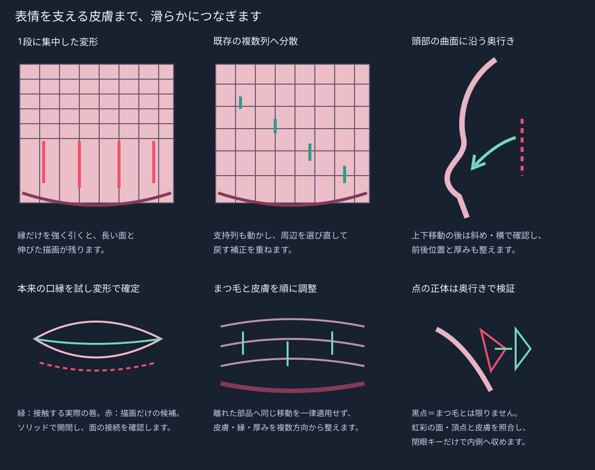

# 構造と変形の判断

## 本来の口を確定する

テクスチャで口に見える場所と、メッシュの口縁は一致するとは限りません。正面と斜めのソリッド・ワイヤーで、上下の唇、口角、奥の面を確認します。境界辺の有無や同じ成分であることだけで、穴の存在や唇の融合を断定しません。

候補を少し広い接続範囲で動かし、上下唇がどう離れるかを撮影します。裏の面を引っ張っていないか、元の口の線が別に残っていないかを見て、試し変形を戻します。これが部位特定の確認です。口内がなくても、既存の口縁を目標へ動かせます。構造が本当に融合していて既存頂点の移動では成立しない場合は、必要な構造変更を別の依頼として相談します。

## 瞼の動きを複数列へ配る

閉じ目の線を作るだけでは不十分です。縁のすぐ上の一段が長く伸び、眉側が固定されたままなら、影響範囲を上へ広げます。大きめの範囲で動かした後、別の点から戻す補正を重ねます。複数列の移動量が連続し、列間隔が急に変わらないようにします。均一な平滑化を一律に掛けると輪郭や描画も崩れるため、対象と保持する縁を明示します。

広い変形後に眉の位置・形と周辺を戻し、眉と瞼の間を再分配します。初めから眉下を固定して一段へ伸びを集中させません。

上9割・下1割は出発点です。元の形状、下瞼の厚み、目尻の曲率に合わせて調整します。まつ毛の元の弧をそのまま平行移動せず、中央を主に下げ、両端へなだらかに移動量を減らします。強度50%でも自然に眼が覆われるかを見ます。

## 前後方向と分離部品

下がった瞼が元の深さのままだと頭部から浮きます。正面の輪郭が良くても、横と左右45度で額・眼窩・瞼へ続く曲面を確認します。斜めと横を見ながら前後も編集し、眼窩の奥と頭部外側を取り違えません。上下一律の深さや一定の押し込み量を普遍的な設定にしません。

まつ毛、皮膚、眉、虹彩、ハイライトが別成分なら順に調整します。顔自体に同じ線が描かれ、上に別のまつ毛部品がある場合は両方を合わせます。閉眼で黒い点が出たら毛だと即断せず、虹彩・反射部品と皮膚の前後関係も調べます。既存の眼を閉眼キーで少し奥へ収める方法も使えますが、通常顔を変えず、中間値で眼の見え方を確認します。

## 笑顔と「あ」

口角のみを上げると、中央の唇や頬との関係が不自然になります。口角から上下唇・周囲の皮膚へ変位を配り、唇の弧と厚み、奥行きを全体で見ます。「あ」も既存の開口縁とその周囲を動かします。目標画像に歯や舌が描かれていても、依頼外の形状・テクスチャを追加する根拠にしません。
