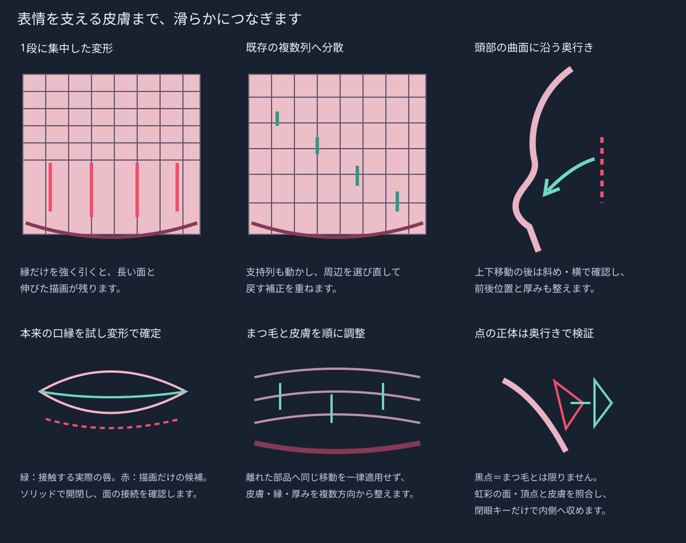

# Judging structure and deformation

## Determine the actual mouth

The place that looks like a mouth in the texture does not necessarily match the mesh's lip edges. Check the upper and lower lips, mouth corners and the surfaces behind them in Solid and Wireframe from the front and obliquely. Do not conclude that a hole exists or that the lips are fused from the presence of boundary edges or from being the same component alone.

Move the candidate over a slightly wider connected range and capture how the upper and lower lips separate. Check whether you are pulling the back surface and whether the original mouth line remains separately, then undo the test deformation. This is the confirmation that identifies the part. Even without a mouth interior, you can move the existing lip edges toward the target. If the structure is truly fused and movement of existing vertices cannot achieve it, discuss the necessary structural change as a separate request.

## Distribute eyelid motion across several rows

Creating the closed-eye line alone is not enough. If the single row just above the rim stretches long while the brow side stays fixed, widen the influence upward. After moving a larger range, layer corrections that pull back from other points. Keep the movement continuous across rows and avoid sudden changes in row spacing. Applying uniform smoothing everywhere also breaks contours and painting, so state explicitly what is targeted and which edges are preserved.

After the broad deformation, restore the brows' position, shape and surroundings, and redistribute the area between the brows and the eyelids. Do not fix the area below the brows from the start and concentrate the stretch in one row.

90% upper and 10% lower is a starting point. Adjust it to the original shape, the lower eyelid thickness and the curvature of the outer eye corner. Do not translate the eyelashes' original arc as it is; lower mainly the center and gradually reduce the movement toward both ends. Check whether the eye is covered naturally even at 50% strength.

## Depth direction and separate parts

If a lowered eyelid keeps its original depth, it floats off the head. Even if the front contour looks good, check the surface curvature continuing from the forehead through the eye socket to the eyelid at profile and left/right 45 degrees. Edit depth while looking at the oblique and profile views, and do not confuse the back of the eye socket with the outside of the head. Do not make a uniform top-to-bottom depth or a fixed push-in amount a universal setting.

If the eyelashes, skin, brows, iris and highlights are separate components, adjust them in order. When the same line is painted on the face itself and a separate eyelash part sits on top, adjust both. If a black dot appears in the closed eye, do not immediately assume it is hair; also examine the depth relationship between the iris, reflection parts and skin. You can also use the approach of setting the existing eye slightly deeper in the closed-eye key, but do not change the neutral face, and check how the eye looks at intermediate values.

## Smile and "aa"

Raising only the mouth corners makes the relationship with the center of the lips and the cheeks unnatural. Distribute displacement from the corners to the upper and lower lips and the surrounding skin, and look at the lip arc, thickness and depth as a whole. "aa" likewise moves the existing opening rim and its surroundings. Even if the target image shows teeth or a tongue, do not use that as grounds to add shapes or textures outside the request.
