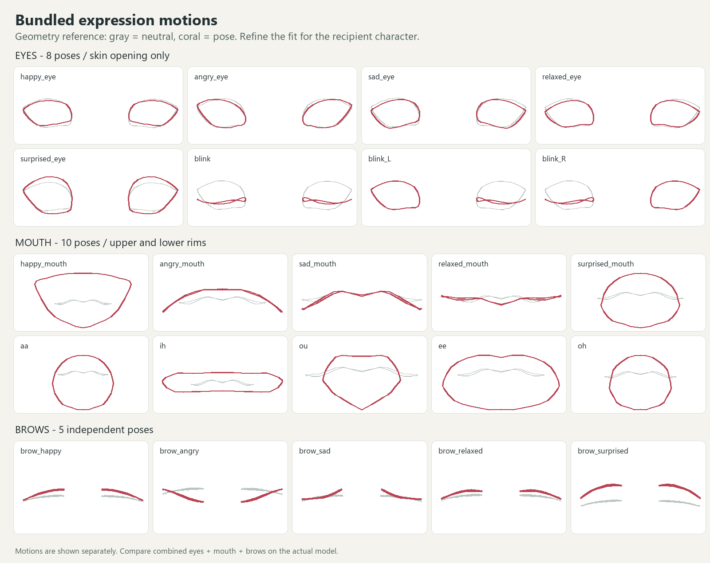

# 目・口・眉のフィットと転送

前提：commands.mdの方法で `helper = studio.attach(WORK, ...)` を用意し、固定カメラの `front`（顔からカメラへ）と `up` を画像で確認します。以下のOBJECT、SEED、頂点配列は、今回観察したモデルの値です。例の変数をそのまま使いません。

## 同梱ポーズの動きを見る



灰が通常顔、赤がポーズです。各セルは見やすく拡大しており、セルをまたぐ大きさの比較には使いません。これはテクスチャ・まつ毛を除いた動きの見本です。仕上がりの可愛さは受け手モデルの画像で判断し、必要ならその通常顔から目標を生成します。

## 部位を見つけるための情報

`helper.inspect_mesh(OBJECT)` は世界座標points、カメラ基準frame_points（右・奥・上）、連結components、境界boundaries、edgesを返します。意味の分類はしません。必要な部品・境界だけ取り出して座標や画像と照合します。全頂点をコンテキストへ出力しません。

`helper.list_blink_parts([OBJECT])` と `helper.capture_blink_parts([OBJECT], angles=['Front'])` は、連結部品を色と番号で表示します。部品が多い場合は対象だけを観察します。色分けだけで同じメッシュ内の癒着を見逃さず、口の穴・目の縁は斜めのワイヤーでも確認します。選択はそのモデルのsessionに保存され、再利用時は元のBasis・トポロジーと照合されます。

## 目：8点→皮膚マスク→8表情

```python
helper.prepare_blink(OBJECT, skin_seed=SKIN_SEED)
helper.set_blink_points(POINTS)  # 8点の世界座標。部分更新も可能
helper.set_blink_followers(FOLLOWERS)  # [{'object':NAME,'seed':ID}, ...]
helper.fit_blink()
helper.capture_fit(angles=['Front','Oblique45','Profile90'])
# 画像で皮膚の縁、奥行き、選んだまつ毛等を確認してから
helper.transfer_eyes(reviewed=True)
```

POINTSのキーは `eyeInnerL/eyeOuterL/eyeUpperL/eyeLowerL` とR側です。Lはカメラ基準の右、Rは左です（通常の正面像でLが画面右）。虹彩の外周やまつ毛先端でなく、皮膚の開口縁へ置きます。画像画素から指定する `set_blink_pixels`、深さやマスク自体の補正はcommands.mdを参照します。

同じフィットを通常顔と全ポーズへ適用し、編集できる表情の土台を作ります。目尻・複数列の変形・上瞼の奥行きは転送後の画像で仕上げます。`transfer_blink(reviewed=True)` は閉眼だけ、`transfer_eyes(expressions=['blink','happy_eye'], reviewed=True)` は一部だけ転送します。8種：happy_eye, angry_eye, sad_eye, relaxed_eye, surprised_eye, blink, blink_L, blink_R。

同梱blinkの元ポーズは主に上下の動きで、前後変位は実質ゼロです。通常顔で張り出した瞼が、閉眼ではそのまま低い位置へ残る場合があります。代表のblinkを横から見て、皮膚を顔の曲面へ収め、まつ毛は皮膚へ埋まらない位置へ別に整えます。皺を平滑化する前に奥行きが原因かを確かめます。全モデル共通の前後移動量は設定しません。

目の追従に眉を入れません。まつ毛が顔以外のオブジェクトに混在する場合もあるので、顔だけを調べて完了とせず、閉眼像に残る部品をたどります。オブジェクト名や小ささだけで追従対象を決めません。虹彩や反射部品は目の構造を見て判断します。閉眼で貫通するなら閉眼キーで収める等の局所補正を行い、中間値で不自然な縮みがないか見ます。

## 口：上下の弧→口縁の動き→接続皮膚

口マスクを近接面のSurface Deformだけで転送すると、ほぼ接している上唇と下唇の対応が混ざります。ここでは同梱マスクから抽出した上下の口縁の動きを別々に渡します。

1. ソリッド／ワイヤーで本来の開口を見て、両口角と上下それぞれの途中頂点を選びます。上下を境界全体の平均高さで決めません。唇の厚みや反りで逆転します。曖昧なら作業キー上で小さな試し変形をして戻します。
2. 実際の境界辺をたどるか、下の補助で二つの弧を取り出します。両弧は同じ左右口角を端点に持ち、内部頂点は共有しません。枝になった境界の余分な先端は対応から外すだけで、削除しません。
3. 赤の上唇と青の下唇を画像で確認し、転送します。

```python
arcs = helper.mouth_paths(OBJECT, SKIN_SEED, corners=[CORNER_A,CORNER_B], upper=UPPER_MIDDLE, lower=LOWER_MIDDLE)
helper.prepare_mouth(OBJECT, SKIN_SEED, **arcs)
helper.capture_mouth_fit(angles=['Front','Oblique45'])
helper.transfer_mouth(reviewed=True)
```

必要なら `prepare_mouth(..., upper=[...], lower=[...], support=2.85, protected=[...])` と弧や保護頂点を直接指定します。supportは口幅に対する接続距離です。口縁の動きを弧の長さで対応させ、上下・左右・前後の変位を周辺皮膚へなだらかに配ります。通常顔を平滑化しません。広すぎて鼻・頬の印象が変われば範囲や保護頂点を調整し、狭すぎて一列が伸びれば広げます。形を見て選びます。

10種：happy_mouth, angry_mouth, sad_mouth, relaxed_mouth, surprised_mouth, aa, ih, ou, ee, oh。元素材のamgry_mouthはangry_mouthへ正規化しています。`transfer_mouth(expressions=['aa','happy_mouth'], reviewed=True)` も可能です。

口の穴が本当に無い場合、この方式だけで開口は作れません。テクスチャの境界や裏面を口と決めて無理に開かず、可能な変形と必要な構造変更を説明します。口内が無いこと自体は問題ありません。

## 眉：独立した左右部品→5表情

```python
helper.prepare_brows({
  'L': {'object':OBJECT_L,'seed':BROW_L},
  'R': {'object':OBJECT_R,'seed':BROW_R},
})
helper.transfer_brows(reviewed=True)
```

眉の幅と元の曲線に合わせた単純なドライバーを作り、左右それぞれの動きを転送します。5種：brow_happy, brow_angry, brow_sad, brow_relaxed, brow_surprised。目の感情キーとは別なので、組合せで強度を調整できます。

皮膚に描かれた眉や眉下の皮膚も追従させる必要がある場合だけ、`prepare_brows(..., skin={'object':HEAD,'seed':SKIN_SEED}, protected=EYE_RIM_IDS, support=.8, full=.36)` を使います。protectedは目の開口縁の実頂点です。support/fullは眉幅の比で、指定範囲へ眉の実際の変位をなだらかに渡し、目縁ではゼロにします。目と眉の間に急な段差ができたら範囲を再調整します。眉を皮膚と一緒に最近傍ドライバーへ接続すると上瞼が大きく伸びる場合があるため、眉の転送後に皮膚を追従させます。

眉が皮膚と一体の場合は勝手に切断せず、作業キーの局所編集を使います。小さな連結部品を眉と自動判定しません。

## 比較・再調整

```python
helper.capture('aa', .5, angles=['Front'])
helper.capture('aa', 1, angles=['Front','Oblique45','Profile90','Other45'])
helper.capture(combination={'happy_eye':.8,'happy_mouth':1,'brow_happy':.6}, angles=['Front','Oblique45'])
helper.expression('blink', 0)  # 作業キーを通常顔へ
helper.note('目尻が尖る', '周囲を含めて戻す', '弧が滑らかになった', '横で厚みを見る')
helper.save(export=True)
```

再転送は同名の作業キーの局所仕上げを置き換えます。残したい状態は保存してから行います。目は再fit後に再転送、口・眉は対応指定を再調整して再転送します。転送後の局所編集では接続のみのプロポーショナル編集を基本に、広い変形と周囲の戻しを反復します。

まず代表表情を直し、共通の対応が良くなってから残りをまとめて確認すると効率が上がります。全表情依頼では23の部位キーを作れますが、旧3表情（aa/blink/happy）を埋めることは完了条件ではありません。happyは旧互換の空キーで、新規制作ではhappy_eye/mouthとbrow_happyの組合せを使います。
