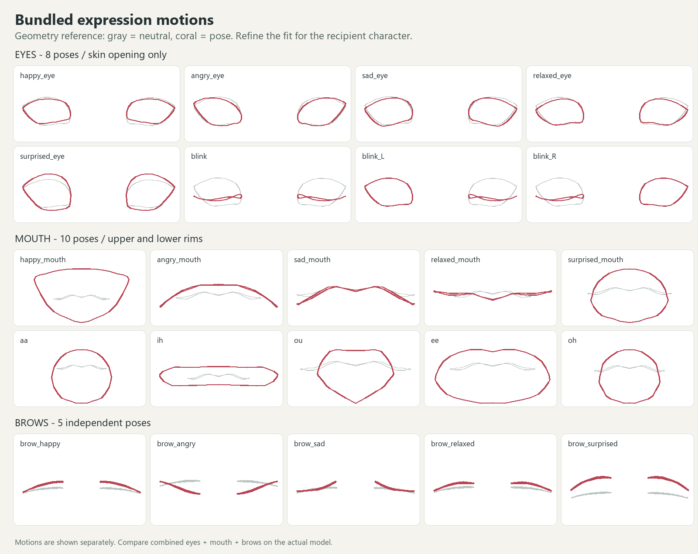

# Fitting and transferring eyes, mouth and brows

Prerequisite: prepare `helper = studio.attach(WORK, ...)` as described in commands.md, and confirm the fixed camera's `front` (from the face toward the camera) and `up` in images. The OBJECT, SEED and vertex arrays below are values from the model observed for this request. Do not use the example variables as they are.

## Look at the motion of the bundled poses



Gray is the neutral face and red is the pose. Each cell is enlarged for legibility and is not for comparing sizes across cells. This is a sample of motion with textures and eyelashes removed. Judge the cuteness of the result from images of the receiving model, and if needed generate a target from its neutral face.

## Information for finding parts

`helper.inspect_mesh(OBJECT)` returns world-coordinate points, camera-relative frame_points (right, depth, up), connected components, boundaries and edges. It does not classify meaning. Extract only the parts and boundaries you need and check them against coordinates or images. Do not output all vertices into the context.

`helper.list_blink_parts([OBJECT])` and `helper.capture_blink_parts([OBJECT], angles=['Front'])` display connected parts with colors and numbers. When there are many parts, observe only the targets. Do not miss fusion within the same mesh just because of the coloring, and also check the mouth opening and eye rims in oblique Wireframe. Selections are saved in that model's session and, when reused, are checked against the original Basis and topology.

## Eyes: 8 points → skin mask → 8 expressions

```python
helper.prepare_blink(OBJECT, skin_seed=SKIN_SEED)
helper.set_blink_points(POINTS)  # world coordinates of the 8 points; partial updates are possible
helper.set_blink_followers(FOLLOWERS)  # [{'object':NAME,'seed':ID}, ...]
helper.fit_blink()
helper.capture_fit(angles=['Front','Oblique45','Profile90'])
# after confirming the skin rim, depth, selected eyelashes and so on in images
helper.transfer_eyes(reviewed=True)
```

POINTS keys are `eyeInnerL/eyeOuterL/eyeUpperL/eyeLowerL` plus the R side. L is camera-right and R is camera-left (in a normal front image, L is the right side of the screen). Place them on the skin's opening rim, not on the iris outline or the eyelash tips. For specifying from image pixels with `set_blink_pixels`, and for corrections to depth or the mask itself, see commands.md.

Apply the same fit to the neutral face and all poses to create a base for editable expressions. Finish the outer eye corners, multi-row deformation and upper eyelid depth in images after transfer. `transfer_blink(reviewed=True)` transfers only the closed eye, and `transfer_eyes(expressions=['blink','happy_eye'], reviewed=True)` transfers only some. The 8 are: happy_eye, angry_eye, sad_eye, relaxed_eye, surprised_eye, blink, blink_L, blink_R.

The bundled blink's original pose is mostly up-and-down motion, with essentially zero depth displacement. An eyelid that bulges out in the neutral face may remain at the same low position when closed. Look at the representative blink from the side, fit the skin to the face's surface curvature, and adjust the eyelashes separately to a position where they do not sink into the skin. Before smoothing wrinkles, confirm whether depth is the cause. Do not set a front-back movement amount common to all models.

Do not include the brows in the eye followers. Eyelashes may also be mixed into objects other than the face, so do not finish after examining only the face; trace the parts remaining in the closed-eye image. Do not decide followers from object names or smallness alone. Judge the iris and reflection parts by looking at the eye structure. If they penetrate in the closed eye, make local corrections such as setting them deeper in the closed-eye key, and check intermediate values for unnatural shrinking.

## Mouth: upper and lower arcs → lip-edge motion → connected skin

Transferring the mouth mask with Surface Deform on nearby faces alone mixes up the correspondences of the almost-touching upper and lower lips. Here, the motions of the upper and lower lip edges extracted from the bundled mask are passed separately.

1. Look at the actual opening in Solid/Wireframe, and select both mouth corners and the middle vertex of the upper and lower edges. Do not decide upper and lower by the average height of the whole boundary. Lip thickness and curl can invert it. If it is ambiguous, make a small test deformation on a work key and revert it.
2. Trace the actual boundary edges, or extract the two arcs with the helper below. Both arcs have the same left and right mouth corners as endpoints and share no interior vertices. Just exclude the extra tips of branched boundaries from the correspondence; do not delete them.
3. Confirm the red upper lip and blue lower lip in images, then transfer.

```python
arcs = helper.mouth_paths(OBJECT, SKIN_SEED, corners=[CORNER_A,CORNER_B], upper=UPPER_MIDDLE, lower=LOWER_MIDDLE)
helper.prepare_mouth(OBJECT, SKIN_SEED, **arcs)
helper.capture_mouth_fit(angles=['Front','Oblique45'])
helper.transfer_mouth(reviewed=True)
```

If needed, specify the arcs and protected vertices directly with `prepare_mouth(..., upper=[...], lower=[...], support=2.85, protected=[...])`. support is the connection distance relative to mouth width. Match the lip-edge motion by arc length and distribute the up-down, left-right and front-back displacement smoothly onto the surrounding skin. Do not smooth the neutral face. If it is too wide and changes the impression of the nose or cheeks, adjust the range or protected vertices; if it is too narrow and one row stretches, widen it. Choose by looking at the shape.

The 10 are: happy_mouth, angry_mouth, sad_mouth, relaxed_mouth, surprised_mouth, aa, ih, ou, ee, oh. The original asset's amgry_mouth is normalized to angry_mouth. `transfer_mouth(expressions=['aa','happy_mouth'], reviewed=True)` is also possible.

If there really is no mouth opening, this method alone cannot create one. Do not decide that a texture boundary or back surface is the mouth and force it open; explain the possible deformations and the structural change that is needed. The absence of a mouth interior is not a problem in itself.

## Brows: separate left and right parts → 5 expressions

```python
helper.prepare_brows({
  'L': {'object':OBJECT_L,'seed':BROW_L},
  'R': {'object':OBJECT_R,'seed':BROW_R},
})
helper.transfer_brows(reviewed=True)
```

Create a simple driver matched to the brow width and original curve, and transfer the left and right motion separately. The 5 are: brow_happy, brow_angry, brow_sad, brow_relaxed, brow_surprised. They are separate from the eye emotion keys, so strength can be adjusted in combinations.

Only when the brows painted on the skin or the skin below the brows must also follow, use `prepare_brows(..., skin={'object':HEAD,'seed':SKIN_SEED}, protected=EYE_RIM_IDS, support=.8, full=.36)`. protected is the actual vertices of the eye's opening rim. support/full are ratios of the brow width; they pass the brows' actual displacement smoothly into the specified range and bring it to zero at the eye rim. If a sharp step appears between the eyes and brows, readjust the range. Connecting the brows to the nearest-neighbor driver together with the skin can greatly stretch the upper eyelid, so make the skin follow after the brow transfer.

If the brows are fused with the skin, do not cut them apart on your own; use local editing on a work key. Do not automatically decide that a small connected part is a brow.

## Comparison and readjustment

```python
helper.capture('aa', .5, angles=['Front'])
helper.capture('aa', 1, angles=['Front','Oblique45','Profile90','Other45'])
helper.capture(combination={'happy_eye':.8,'happy_mouth':1,'brow_happy':.6}, angles=['Front','Oblique45'])
helper.expression('blink', 0)  # return the work key to the neutral face
helper.note('outer eye corner is pointed', 'pull back including the surroundings', 'the arc became smooth', 'check thickness from the side')
helper.save(export=True)
```

Retransferring replaces the local finishing on the work keys of the same name. Save the state you want to keep first. For the eyes, refit and then retransfer; for the mouth and brows, readjust the correspondence specification and retransfer. For local editing after transfer, base the work on proportional editing with Connected Only, repeating broad deformation and restoration of the surroundings.

It is more efficient to fix representative expressions first and then check the rest together once the shared correspondences improve. An all-expressions request can create 23 part keys, but filling the legacy three expressions (aa/blink/happy) is not a completion criterion. happy is an empty key kept for legacy compatibility; new production uses combinations of happy_eye/mouth and brow_happy.
